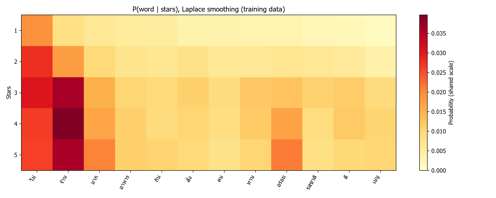
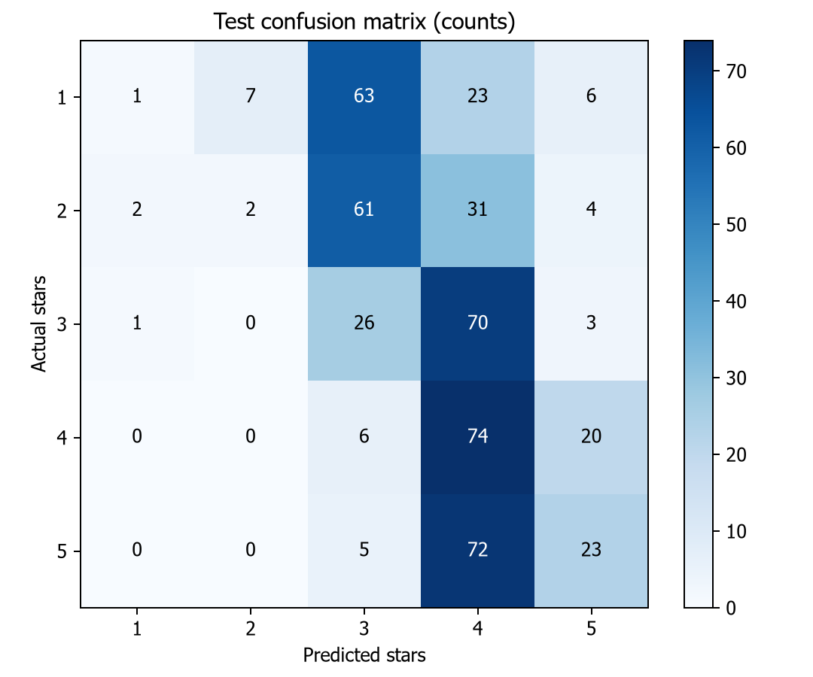

# ผลการทดลอง Naive Bayes

Train 19,458 รีวิว / Test 500 รีวิว ตามชุดแบ่งเดิมของ Dataset
คลังคำ 22,354 คำ ใช้ Laplace smoothing = 1

- Accuracy: **25.20%**
- Macro-F1: **0.1900**
- Baseline ทาย 4 ดาวทุกรีวิว: 20.00%

```text
              precision    recall  f1-score   support

           1       0.25      0.01      0.02       100
           2       0.22      0.02      0.04       100
           3       0.16      0.26      0.20       100
           4       0.27      0.74      0.40       100
           5       0.41      0.23      0.29       100

    accuracy                           0.25       500
   macro avg       0.26      0.25      0.19       500
weighted avg       0.26      0.25      0.19       500
```

ข้อมูลฝึกส่วนใหญ่เป็น 4–5 ดาว ขณะที่ test มีดาวละ 100 รีวิว
ผลของ 1–2 ดาวยังต่ำ และโมเดลนับคำแยกกันจึงไม่เข้าใจวลี เช่น “ไม่อร่อย”
ตัวอย่างทายถูกและผิดอยู่ใน [examples.csv](examples.csv)



Heatmap ใช้ P(คำ | ดาว) เลือก 8 คำที่มีค่าสูงสุดของแต่ละดาวแล้วรวมโดยไม่ซ้ำ
Word Cloud ใช้ความถี่คำจาก train มีภาพรวมและแยก 1–5 ดาว ขนาดคำปรับแยกในแต่ละภาพ


